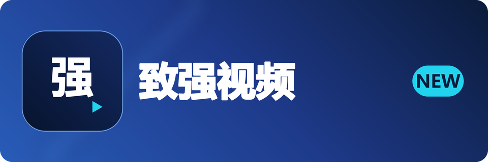
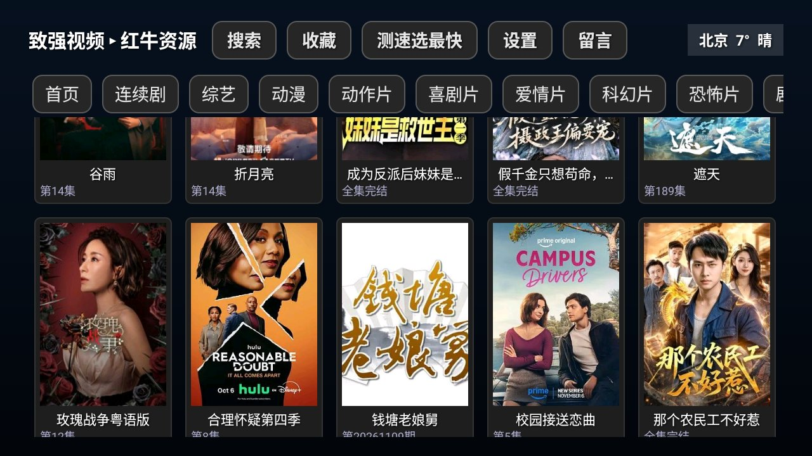
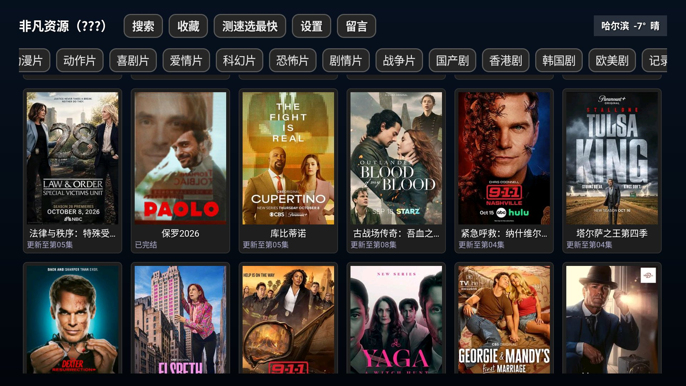

<p align="center">
  
</p>

# DuSheNative · ZhiQiang Video (致强视频)

> A **native** Android TV video client built for **legacy TVs / TV boxes** (Android 4.1~4.4, 1GB RAM).
> No WebView — the UI and player are fully native; ships with **ExoPlayer 2.14.2** for software-decoded m3u8/HLS, so old boxes play smoothly too.

**Current version: v4.7 · versionCode 63 · package `com.dushetv.box`** &nbsp;|&nbsp; [中文 README](README.md)

---

## What is this

- **Fully native**: pure Java + XML, no WebView, no front-end framework. Low memory footprint, fast startup, and responsive D-pad navigation on low-end boxes.
- **TVBox API spec**: compatible with Apple CMS (`ac=list` / `ac=detail`) collection sites. Ships with a set of built-in direct sources, supports **one-click speed test, dead-link filtering, and fastest-source-first** at runtime.
- **Legacy device tuning**: forced relaxed TLS (old box SSL stacks disable TLS 1.1/1.2 by default, causing modern HTTPS handshake failures); Punycode conversion for Chinese domain names; poster downsampling + LRU cache.
- **Apple TV style UI**: 6-column grid, card focus zoom + gold glow, category bar, search, favorites, watch history, and remote-configurable wallpaper / weather / ad slots.
- **Remote update channel**: silently checks `update.json` on boot and prompts for new versions; the update URL is remotely configurable.

## Features

| Module | Description |
|---|---|
| Home browsing | 6-column grid + category bar (Home / Movies / TV / Variety / Shorts / Anime / Documentary / Other), 30 items per page, left/right to flip pages |
| Source speed test | Concurrent probes to all direct sources (reads only the first 24KB), sorted by response time, auto-picks the fastest usable source |
| Search | Keyword search + pinyin assist; results sorted by quality / play count |
| Detail / Playback | Auto-selects an m3u8 line on the detail page; ExoPlayer with hardware/software decode, auto-fallback to the system player (dual-engine) |
| Favorites / History | Local favorites + watch history |
| Remote config | Update channel, direct-source list, ads / wallpaper / weather all delivered by remote JSON with silent refresh |

## Screenshots

Actual screenshots of the client running on a TV / box (MuMu emulator, landscape):

| Home grid | Detail / list |
|---|---|
|  |  |

> More UI & branding: the app icon is a **“强” (strength) glyph with a cyan play triangle**, available in three specs (1:1 / 16:9 / 3:1) with generator scripts in [`app-icons/`](app-icons/); see the preview page [`app-icons/preview.html`](app-icons/preview.html).

## Quick start (30 seconds)

```bash
# 0) Prereqs: JDK 17 + Android SDK (point ANDROID_HOME to your SDK)
# 1) Write your SDK path
cd source
cp local.properties.example local.properties
#    Edit local.properties and set sdk.dir to your real SDK path

# 2) One-click build (Gradle 8.4 wrapper is included — no need to install Gradle)
./gradlew assembleRelease          # Linux / macOS
gradlew.bat assembleRelease        # Windows

# 3) Output
#    app/build/outputs/apk/release/app-release.apk
```

> **About signing**: the repo does NOT include the signing key (`source/keystore/` is git-ignored). On first build, if `source/keystore/debug.keystore` is missing, Gradle auto-generates a demo key and signs with it. For your own releases, replace it with your own keystore and update `signingConfigs.compat` in `source/app/build.gradle`.

Install the APK on your TV or box via USB drive / adb.

## Source guide

Per-file explanations are in [`03-源码导读.md`](03-源码导读.md) (Chinese). Core code lives in `source/app/src/main/java/com/dushetv/box/`:

```
Net.java            # Relaxed TLS + URL normalization + speed probe + disk HTTP cache
SpeedTest.java      # Concurrent speed test / sorting
ApiConfig.java      # TVBox config parsing + JSON cleanup
SiteApi.java        # type0/1 API calls + rating sorting
ImageLoader.java    # Poster downsampling + LRU + in-flight dedup
MainActivity.java   # Home browsing / nav / speed-test UI + built-in source table + D-pad focus
DetailActivity.java # Detail / episodes / m3u8-first
PlayerActivity.java # Playback (ExoPlayer + system player fallback)
SearchActivity.java # Search
FavActivity.java    # Favorites
```

## Directory structure

```
GTA567/
├── README.md                  # This file (intro / quick start)
├── README.en.md               # English README
├── LICENSE                    # MIT
├── 01-工具与环境.md           # Tool list + environment setup + build commands (Chinese)
├── 02-任务记录.md             # Development log + real-device TV bug post-mortems (Chinese)
├── 03-源码导读.md             # Per-file source guide (Chinese)
├── source/                    # Independently compilable source (with Gradle 8.4 wrapper)
│   ├── settings.gradle
│   ├── build.gradle
│   ├── gradle.properties
│   ├── local.properties.example
│   ├── gradlew / gradlew.bat
│   └── app/
│       ├── build.gradle       # version / signing / ExoPlayer dependencies
│       └── src/main/          # Java sources + res resources + AndroidManifest
├── release/
│   └── dushetv-v4.7.apk       # Release APK
├── screenshots/               # Client UI screenshots (MuMu emulator)
├── server/                    # Remote config examples (update channel / ads / sources)
└── app-icons/                 # Brand icons (generator scripts + three-spec PNGs)
```

## Version history (recent)

| Version | code | Highlights |
|---|---|---|
| v4.7 | 63 | Loading animation only on first load (paging/category/search no longer blocks browsing); faster speed test; disk HTTP cache speeds up images |
| v4.6 | 62 | D-pad “up” two-stage return to the top nav bar; scrolling poster loading animation |
| v4.5 | 61 | Update channel migrated to self-hosted 7vga.cn/zqnew |
| v4.4 | 60 | Brand icon changed from “致” to the “强” glyph |

## FAQ

**1. The repo has no signing key — can the APK still be used?**
Yes. `release/dushetv-v4.7.apk` is an **already-signed** release APK; install and run it directly — **no key required**. The signing key is only needed to repackage / ship a new version. Keeping it private prevents others from forging a same-signed package and is unrelated to using the app.

**2. Is the APK built from a clone the same as the one in release/?**
Same functionality, **different signature**. The repo’s `source/` does not include the official signing key; if none is present, a demo key is auto-generated (`ensureKeystore` task in `app/build.gradle`). So a self-built APK installs and runs, but **cannot overwrite the official release/** (different signature — uninstall first). For official releases, use your own keystore and update `signingConfigs.compat`.

**3. What environment do I need to build?**
JDK 17 + Android SDK (set `sdk.dir` in `local.properties`). The repo includes the **Gradle 8.4 wrapper**, so no separate Gradle install: just `./gradlew assembleRelease`.

**4. How do I change the default source / add a source?**
Edit `BUILTIN_DIRECT` in `source/app/src/main/java/com/dushetv/box/MainActivity.java` and add a line like `{"name","https://api-url"}`.

## License

- This repository is released under the **MIT License** (see [`LICENSE`](LICENSE)).
- Video sources are provided by third parties. Please follow local laws and **do not use this for piracy**.

---

*This project was developed, built and maintained from scratch by **WorkBuddy (an AI agent)** — writing code, fixing TV D-pad focus bugs, cleaning dead sources, bumping versions, and building the APK were all driven by single-sentence instructions (see [`02-任务记录.md`](02-任务记录.md) for details).*
