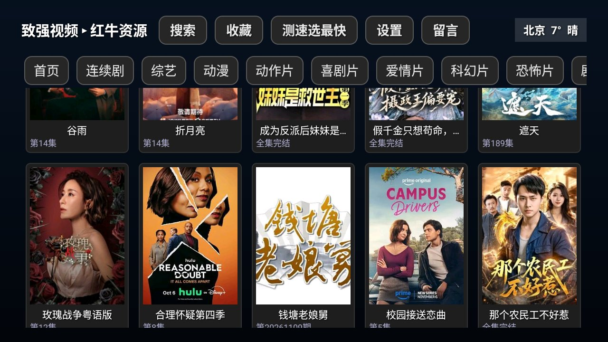
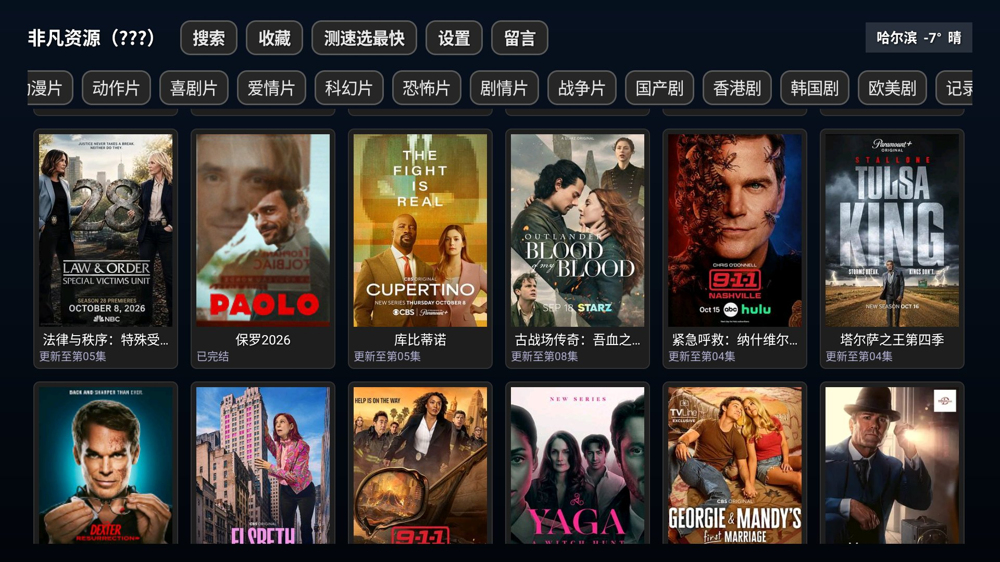

# 致强视频 · DuSheNative

> 一款面向 **老电视 / 电视盒子**（Android 4.1~4.4、1G 内存）的**原生** Android TV 影视客户端。
> 不依赖 WebView，UI 与播放器全部原生渲染；内置 **ExoPlayer 2.14.2**，软解 m3u8/HLS，老盒子也能流畅播放。

**当前版本：v4.7 · versionCode 63 · 包名 `com.dushetv.box`**

---

## 这是什么

- **原生实现**：纯 Java + XML，不用 WebView、不用前端框架。对低配老盒子内存占用小、启动快、焦点导航跟手。
- **TVBox 接口规范**：兼容苹果 CMS（`ac=list` / `ac=detail`）直连采集站，内置一批直连源，支持运行时**一键测速、自动过滤死链、最快源优先**。
- **老设备适配**：强制放宽 TLS（老盒子 SSL 栈默认关掉 TLS1.1/1.2，现代 HTTPS 源会握手失败）；URL 中文域名 Punycode 转码；海报降采样 + LRU 缓存。
- **苹果 TV 风格 UI**：六列网格、卡片聚焦放大 + 金边光晕、分类条、搜索、收藏、观看历史、远程壁纸 / 天气 / 广告位配置。
- **远程升级通道**：开机静默检查 `update.json`，发现新版本提示升级；升级地址可远程改。

## 主要功能

| 模块 | 说明 |
|---|---|
| 首页浏览 | 六列网格 + 分类条（首页 / 电影 / 电视剧 / 综艺 / 短剧 / 动漫 / 纪录片 / 其他），每页 30 条，左右键翻页 |
| 线路测速 | 并发对全部直连源发探针（只读前 24KB），按响应耗时排序，自动选最快可用源 |
| 搜索 | 关键字搜索 + 拼音辅助，结果按画质 / 播放量排序 |
| 详情 / 播放 | 详情页自动选中含 m3u8 的线路；ExoPlayer 软硬解，失败自动回退系统播放器（双引擎兜底） |
| 收藏 / 历史 | 本地收藏 + 观看历史 |
| 远程配置 | 升级通道、直连源列表、广告 / 壁纸 / 天气均由远程 JSON 下发，可静默更新 |

## 界面预览

客户端在电视 / 盒子上运行的实测截图（MuMu 模拟器，横屏）：

| 首页浏览 | 详情 / 列表 |
|---|---|
|  |  |

> 更多界面与品牌：品牌图标为「强」字 + 青色播放三角，三款规格（1:1 / 16:9 / 3:1）与生成脚本见 [`app-icons/`](app-icons/)，预览页 [`app-icons/preview.html`](app-icons/preview.html)。

## 快速开始（30 秒上手）

```bash
# 0) 前置：JDK 17 + Android SDK（ANDROID_HOME 指向你的 SDK）
# 1) 写入你的 SDK 路径
cd source
cp local.properties.example local.properties
#    用编辑器打开 local.properties，把 sdk.dir 改成你的真实路径

# 2) 一键构建（已内置 Gradle 8.4 wrapper，无需手动装 Gradle）
./gradlew assembleRelease          # Linux / macOS
gradlew.bat assembleRelease        # Windows

# 3) 产物
#    app/build/outputs/apk/release/app-release.apk
```

> **关于签名**：仓库不含签名密钥（`source/keystore/` 已从 git 排除）。首次构建时若 `source/keystore/debug.keystore` 不存在，Gradle 会自动生成一个演示密钥并用于签名；发布你自己的版本时，请替换成你自己的 keystore 并同步修改 `source/app/build.gradle` 的 `signingConfigs.compat`。

把 APK 用 U 盘 / adb 装到电视或盒子即可。

## 源码导读

逐文件说明见 [`03-源码导读.md`](03-源码导读.md)。核心代码都在 `source/app/src/main/java/com/dushetv/box/`：

```
Net.java            # TLS 放宽 + URL 规范化 + 测速探针 + 磁盘 HTTP 缓存
SpeedTest.java      # 并发测速 / 排序
ApiConfig.java      # TVBox 配置解析 + JSON 清洗
SiteApi.java        # type0/1 接口调用 + 评分排序
ImageLoader.java    # 海报降采样 + LRU + 在途去重
MainActivity.java   # 首页浏览 / 导航 / 测速 UI + 内置源表 + 遥控器焦点
DetailActivity.java # 详情 / 分集 / m3u8 优先
PlayerActivity.java # 播放（ExoPlayer + 系统播放器回退）
SearchActivity.java # 搜索
FavActivity.java    # 收藏页
```

## 目录结构

```
GTA567/
├── README.md                  # 本文件（介绍 / 快速开始）
├── LICENSE                    # MIT
├── 01-工具与环境.md           # 工具清单 + 环境搭建 + 构建命令
├── 02-任务记录.md             # 开发任务历程 + TV 真机 bug 复盘
├── 03-源码导读.md             # 源码逐文件导读
├── source/                    # 可独立编译的源码（含 Gradle 8.4 wrapper）
│   ├── settings.gradle
│   ├── build.gradle
│   ├── gradle.properties
│   ├── local.properties.example
│   ├── gradlew / gradlew.bat
│   └── app/
│       ├── build.gradle       # 版本号 / 签名 / ExoPlayer 依赖
│       └── src/main/          # Java 源码 + res 资源 + AndroidManifest
├── release/
│   └── dushetv-v4.7.apk       # 成品安装包
├── screenshots/               # 客户端界面截图（MuMu 模拟器实测）
├── server/                    # 远程配置示例（升级通道 / 广告 / 源列表）
└── app-icons/                 # 品牌图标（生成脚本 + 三规格 PNG）
```

## 版本历史（近几版）

| 版本 | code | 要点 |
|---|---|---|
| v4.7 | 63 | 加载动画仅首次显示（翻页 / 分类 / 搜索不挡浏览）；测速提速；磁盘 HTTP 缓存提速图片 |
| v4.6 | 62 | 遥控器「上」键两级回顶导航栏；滚动海报加载动画 |
| v4.5 | 61 | 升级通道迁到自有站点 7vga.cn/zqnew |
| v4.4 | 60 | 品牌图标由「致」改为「强」字版 |

## 常见问题（FAQ）

**1. 仓库没有签名密钥，APK 还能用吗？**
能用。`release/dushetv-v4.7.apk` 是**已签名**的成品安装包，直接安装即可运行，**完全不需要密钥**。签名密钥只在「重新打包 / 以后发新版」时才需要——它不公开，是为了防止他人伪造同签名的安装包，与使用无关。

**2. 克隆源码构建出来的 APK 和 release/ 里的一样吗？**
功能一样，但**签名不同**。仓库里的 `source/` 不含正式签名密钥，构建时若没有密钥会自动生成一把演示密钥（`app/build.gradle` 的 `ensureKeystore` 任务）。因此自己构建的 APK 可以安装使用，但**不能覆盖安装官方 release/ 版**（签名不同需先卸载）；要用作正式发布，请替换成你自己的 keystore 并修改 `signingConfigs.compat`。

**3. 需要什么环境才能构建？**
JDK 17 + Android SDK（`local.properties` 填 `sdk.dir`）。仓库已内置 **Gradle 8.4 wrapper**，无需单独装 Gradle：`./gradlew assembleRelease` 即可。

**4. 想改默认源 / 加源？**
编辑 `source/app/src/main/java/com/dushetv/box/MainActivity.java` 里的 `BUILTIN_DIRECT`，加一行 `{"名字","https://接口地址"}`。

## 许可

- 本仓库以 **MIT 许可证**发布（见 [`LICENSE`](LICENSE)）。
- 影视源由第三方提供，请遵守当地法律法规，**勿用于盗版传播**。

---

*本项目由 **WorkBuddy（AI 智能体）** 从 0 迭代开发、构建与维护——写代码、修 TV 焦点 bug、清理失效源、改版本号、构建 APK 均由一句话指令驱动完成（详见 [`02-任务记录.md`](02-任务记录.md)）。*
